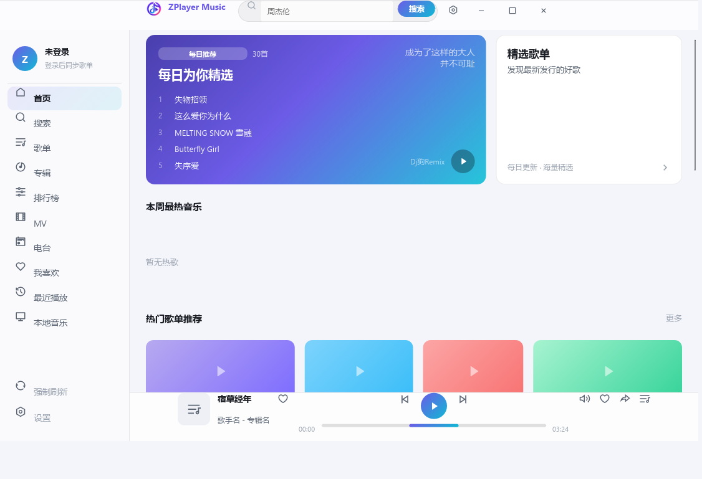

# ZPlayer Music

基于 **Slint + Rust** 的跨平台音乐播放器：紫色主题、无边框自定义标题栏、启动动画，已接入**网易云真实数据**（首页发现 / 搜索 / 播放），支持多音源兜底、MV 播放、本地音乐、我喜欢、最近播放、系统托盘与中英文双语。



## 平台支持

| 平台 | 架构 | 状态 |
| --- | --- | --- |
| Windows | x86_64 | ✅ 自动构建发布 |
| Linux | x86_64 | ✅ 自动构建发布 |
| macOS | Apple Silicon (arm64) | ✅ 自动构建发布 |
| macOS | Intel (x86_64) | ✅ 自动构建发布 |
| Web（浏览器） | wasm32 | ✅ 自动构建发布 |
| Android | 仅 `arm64-v8a` | 🔜 待开发 |
| iOS | 要求 **iOS 18+** | 🔜 待开发 |
| HarmonyOS | — | 🔜 待开发 |

> 移动端说明：Android 端只考虑 `arm64-v8a`（不发布 armeabi-v7a / x86）；iOS 端最低系统版本要求 iOS 18；HarmonyOS 适配计划中。

## 下载

前往 [Releases](https://github.com/hlshell/zplayer_music/releases) 页面下载对应平台的最新发行版：

| 文件 | 平台 | 说明 |
| --- | --- | --- |
| `zplayer-music-windows-x64.zip` | Windows 10/11 x64 | 解压即用，已附带 FFmpeg 运行库（MV 播放所需） |
| `zplayer-music-linux-x64.tar.gz` | Linux x64 | 已内置 FFmpeg 动态库（`lib/`，rpath 自动定位） |
| `zplayer-music-macos-arm64.tar.gz` | macOS (Apple Silicon) | 已内置 FFmpeg 动态库并重写 rpath |
| `zplayer-music-macos-x64.tar.gz` | macOS (Intel) | 同上 |
| `zplayer-music-web.zip` | 任意静态托管 | 解压后用任意 HTTP 服务器托管 `index.html` 即可 |

### 各平台运行要求

- **Windows**：Windows 10 1809+（任务栏 Toast 通知依赖 WinRT）。无需安装额外依赖。
- **Linux**：需要可用的桌面环境（X11 或 Wayland）与 ALSA 音频。发行版已内嵌 FFmpeg 相关动态库；若 MV 无法播放，可执行 `sudo apt install ffmpeg`（Debian/Ubuntu）兜底。
- **macOS**：macOS 12+。首次运行如提示"无法验证开发者"，请在 系统设置 → 隐私与安全性 中允许。
- **Web**：Chrome / Edge / Firefox / Safari 最新版。

## 功能特性

- **首页发现**：每日精选（渐变 Hero + 5 首）、精选歌单、热歌榜、热门歌单、歌手、专辑、新歌速递
- **搜索**：歌曲 / 歌单 / 专辑多类型搜索，带搜索建议
- **播放**：rodio 真实音频驱动（进度、音量、播放/暂停、上/下一首），网易云主源 + 多音源（咪咕/酷我/酷狗/QQ/Joox 等）自动兜底
- **MV 播放**：内嵌 FFmpeg 解码器（软解 + 音频同步）
- **我的音乐**：我喜欢、最近播放、本地音乐（文件夹扫描 + 标签解析 + 拖拽导入）
- **设置**：网络代理、缓存目录、开机自启、语言切换（中/英）
- **桌面集成**：自定义无边框窗口（边缘缩放、标题栏拖拽、位置记忆）、系统托盘、Windows Toast 通知

## 本地构建

### 桌面端（Windows / Linux / macOS）

前置依赖：**Rust stable**（edition 2024）与 **FFmpeg 开发库**（MV 播放功能，`desktop` feature 默认启用）。

<details>
<summary><b>Windows</b></summary>

```powershell
# 1) 用 vcpkg 安装 FFmpeg（一次性，约 20-40 分钟）
git clone https://github.com/microsoft/vcpkg C:\vcpkg
C:\vcpkg\bootstrap-vcpkg.bat
C:\vcpkg\vcpkg install ffmpeg:x64-windows

# 2) 安装 LLVM（bindgen 需要 libclang）：https://github.com/llvm/llvm-project/releases

# 3) 创建本机环境配置（不入库）：新建 .cargo/config.toml，内容见下方模板

# 4) 构建（脚本会自动把 FFmpeg DLL 复制到 exe 同目录）
powershell -NoProfile -ExecutionPolicy Bypass -File build.ps1
```

`.cargo/config.toml` 模板（路径按本机实际情况修改）：

```toml
[env]
VCPKG_ROOT = 'C:\vcpkg'
PKG_CONFIG = 'C:\vcpkg\installed\x64-windows\tools\pkgconf\pkgconf.exe'
PKG_CONFIG_PATH = 'C:\vcpkg\installed\x64-windows\lib\pkgconfig'
LIBCLANG_PATH = 'C:\Program Files\LLVM\bin'
BINDGEN_EXTRA_CLANG_ARGS = '-I"<Windows SDK ucrt 头文件目录>" -I"<MSVC include 目录>"'
```

</details>

<details>
<summary><b>Linux（Debian/Ubuntu）</b></summary>

```bash
sudo apt-get update
sudo apt-get install -y pkg-config clang libclang-dev \
  libasound2-dev libfontconfig1-dev libdbus-1-dev \
  libxcb1-dev libxcb-render0-dev libxcb-shape0-dev libxcb-xfixes0-dev \
  libxkbcommon-dev libwayland-dev libegl1-mesa-dev libgl1-mesa-dev \
  libavcodec-dev libavformat-dev libavutil-dev libswscale-dev libswresample-dev

cargo build --release   # 产物：target/release/zplayer-music
```

</details>

<details>
<summary><b>macOS</b></summary>

```bash
brew install ffmpeg pkg-config
cargo build --release   # 产物：target/release/zplayer-music
```

</details>

开发模式直接 `cargo run`（dev profile 已开基础优化，避免 Slint 首帧白屏）。

### Web（wasm32）

```bash
rustup target add wasm32-unknown-unknown
cargo install wasm-bindgen-cli   # 版本需与 Cargo.lock 中 wasm-bindgen 一致

# 构建 wasm（web feature 不含桌面专属依赖）
cargo build --release --target wasm32-unknown-unknown --no-default-features --features web

# 生成 JS 绑定并组装发布目录
wasm-bindgen --target web --no-typescript \
  --out-dir www target/wasm32-unknown-unknown/release/zplayer-music.wasm
cp web/index.html www/

# 本地预览（任意静态服务器）
python -m http.server -d www 8080
```

## 发布流程（CI）

推送形如 `v*` 的 tag 即可触发 GitHub Actions 自动构建全部平台并创建 Release：

```bash
git tag v0.2.1
git push origin v0.2.1
```

流水线产出：Windows x64 / Linux x64 / macOS arm64 / macOS x64 桌面发行版 + Web 静态包。也可在 Actions 页面手动触发（输入版本号）。

## 项目结构

```
├── Cargo.toml / build.rs   # 依赖与构建脚本（desktop/web/mobile 三维 feature）
├── build.ps1               # Windows 本地发布构建（含 FFmpeg DLL 部署）
├── .github/workflows/      # CI：tag 触发多平台自动构建发布
├── docs/                   # 架构设计文档
├── src/
│   ├── main.rs             # 入口：无边框窗口、启动动画、全局装配
│   ├── core/               # 播放队列、歌词、日志、MV 播放器（FFmpeg 解码）
│   ├── network/            # netease（网易云 weapi）+ sources（多音源兜底）
│   ├── load/               # 首页发现页数据加载（填充 Slint 模型）
│   ├── handlers/           # UI 事件接线：播放/搜索/浏览/收藏/本地/MV/设置
│   ├── persist/            # 配置/缓存/历史/收藏持久化
│   ├── platform/           # 平台门面：音频输出/存储/托盘/自启/文件拖拽
│   ├── i18n/               # 中英文语言包加载
│   ├── web/                # Web(wasm) 专属通道（gdmusic 直连 + WebAudio）
│   └── fonts/simhei.ttf    # Web 端编译期内嵌中文字体
├── ui/
│   ├── appwindow.slint     # 桌面端主窗口装配
│   ├── appwindow-web.slint # Web 端入口（嵌字体）
│   ├── components/         # 标题栏/播放栏/进度条/启动页/数据模型
│   ├── pages/              # 首页/搜索/歌单/专辑/榜单/MV/电台/我喜欢/最近/本地/设置
│   └── assets/             # 图标、语言包
└── web/index.html          # Web 部署入口页
```

## 技术栈

| 层 | 技术 |
| --- | --- |
| UI | Slint 1.18（fluent 样式，桌面原生渲染 / Web femtovg） |
| 语言 | Rust（edition 2024） |
| 音频 | rodio + cpal（桌面）；WebAudio（Web） |
| MV 解码 | FFmpeg（ffmpeg-next 9，支持 FFmpeg 6.x ~ 8.x） |
| 网络 | reqwest（rustls，桌面）/ web-sys fetch（Web） |
| 数据源 | 网易云 weapi（aes-cbc 加密）+ 咪咕/酷我/酷狗/QQ/Joox/YouTube/SoundCloud 兜底 |

## 许可

仅供学习交流使用。音源数据版权归原平台及版权方所有。
